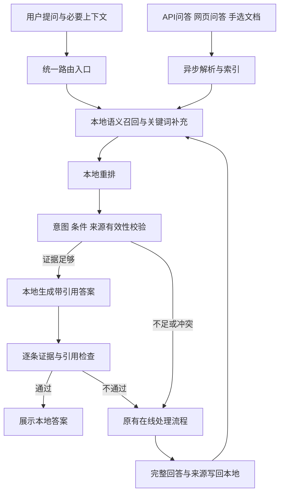

# 本地语义检索与精准问答设计

日期：2026-10-08  
状态：实现及确定性验证已完成，位于 `feat/local-semantic-qa`；实际模型精度和已登录网站实机验收待完成。

适用项目：当前 Flask、React、Electron 工作台。

实施计划：[任务、接口与验收步骤](../plans/2026-10-08-local-semantic-qa-plan.md)。

## 1. 已确认的需求与成功标准

用户希望利用开源项目，先从本地资料中回答问题，只有本地无法获得精准匹配的内容时，才请求在线大模型。资料来源包括：当前项目配置的模型接口对话、网页大模型对话、手动选择的文档或目录。

用户进一步明确：提问之后必须按语义做检索和问答，不以问题字面相同作为主要命中条件。不同措辞可以命中，但答案必须符合当前问题的实际意图和关键条件。

本设计将“精准匹配”定义为：问题意图与证据相符，问题中的对象、版本、时间、数值、单位、否定条件等得到覆盖，答案有可定位的支持材料，且不存在尚未解决的证据冲突。语义相似度和模型自报信心都不能单独证明准确。

成功标准：

- 同义问法能够使用本地材料回答，不需要用户重复原始措辞。
- 主题相似但对象、版本、时间或条件不同的材料不能被直接当作答案。
- 本地回答显示引用来源；引用能够定位到文件、页码、行号或对话消息。
- 本地命中时，在线意图分析、在线问答、网页发送和在线综合模型的请求数均为零。
- 本地不满足匹配规则、依赖不可用或处理超时时，沿用户本次选择的 API 或网页路径兜底。
- 完整在线问答可以成为后续检索的资料，但“保存成功”不等于“内容已被核实”。

## 2. 现有能力与接入边界

| 现有位置 | 当前行为 | 本设计的接入方式 |
|---|---|---|
| `src/App.tsx` 的 `handleSendMessage` | 组织普通对话、自动选模型、网页群聊和在线综合 | 在在线意图分析之前执行统一的本地检查 |
| `server.py` 的 `/api/chat` | 代理 OpenAI 兼容和 Anthropic 原生请求，支持 SSE | 保留上游适配；在新的本地路由结果为 miss 后调用 |
| `electron/main.cjs` 的 `desktop:web-chat` | 通过 `runWebChat` 发起网页问答并保存提取结果 | 只有统一路由未命中才发送；完整结果进入资料收集 |
| `src/lib/desktopBridge.ts` | 声明网页提取、问答和进度桥接 | 扩展可见会话导入及来源定位能力 |
| `server.py` 的 `/api/state` | 按会话保存消息和配置 | 保存完成后异步同步可用问答资料及删除标记 |
| `LocalHubModal.tsx` 与 `/api/local/server/*` | 管理一个 llama-server 子进程 | 复用问答服务；向量及重排使用独立配置的端点 |
| `DirPicker.tsx` 与 `/api/local/fs/list` | 浏览后端机器上的文件系统 | 用于文档和目录的选择，不自动扫描其他目录 |

首版支持当前应用中的普通文本问答，以及从应用聊天输入框选择网页目标发起的问答。网页资料也可以从当前已打开页面的可见会话导入。

各网站原始输入框直接发送仍属于直接在线操作；首版不接管各网站的原生发送按钮，也不拦截应用外 Chrome 的对话。网页本地命中的答案显示在工作台中，不伪装成网站返回的消息。导入的范围是实际读取到的可见历史，不能标记为完整账户历史。

独立 MultiLLM Fusion 服务、Desktop Agent、Claude/Hermes CLI、代码执行及图像生成等有独立协议或副作用的流程，不在本次普通问答路由的实现范围内。相关文字结果以后可以作为显式导入的资料，不能通过缓存重放执行动作。

## 3. 开源组件与选择理由

采用 Chroma、SQLite 和本地模型端点，不在本项目里训练或微调模型。

| 组件 | 职责 | 接入约束 |
|---|---|---|
| llama.cpp | 本地问答、专用 embedding 模型和 reranker 的推理服务 | 三种角色分别配置端点，不假定一个模型兼任三种任务 |
| Chroma | 保存向量，召回语义相关片段 | 桌面单实例使用 `PersistentClient`；显式提交本地生成的向量，禁用默认模型下载 |
| SQLite | 来源、片段、修订、问答缓存、任务和请求记录 | 使用 Python 标准库；数据库是资料状态的权威来源 |
| SQLite FTS5 | 关键词检索，补足型号、版本、路径等精确词项 | 中文采用可重复的字词预处理，原文单独保存；与向量结果做排序融合 |
| BGE 重排模型 | 对当前问题与候选材料重新评分 | 通过本地 rerank 端点使用，例如 `bge-reranker-v2-m3`，不向 Flask 主进程强制引入 PyTorch |
| pypdf、python-docx | PDF 文本与 DOCX 内容解析 | 按文档依赖安装；失败必须明确报告，不能将二进制按文本入库 |

llama.cpp 官方 server 文档列出了兼容聊天、embedding、重排及约束 JSON 输出能力；实际接入仍通过能力探测和响应结构验证确认。[官方文档](https://github.com/ggml-org/llama.cpp/blob/master/tools/server/README.md)

Chroma 提供本地持久化客户端；本设计限定为当前桌面应用的单服务进程使用，不把这一选择外推到多实例生产部署。[客户端文档](https://docs.trychroma.com/reference/python/client)

BGE 的重排输入是问题和材料，输出相关性分数。适配器记录原始分数及归一化方式，不把相关性分数显示为答案正确率。[重排文档](https://github.com/FlagOpen/FlagEmbedding/blob/master/examples/inference/reranker/README.md)

GPTCache 是备选缓存库，但它不能替代证据校验及网页接入。本项目已经用自有代理处理多种上游协议，额外引入其模型适配层收益有限，因此首版不采用。[项目说明](https://github.com/zilliztech/GPTCache)

## 4. 总体结构



本地命中检查只有一个权威入口，所有调用方复用该入口。在线综合模型、内部意图分析或其他辅助模型调用不得递归触发同一轮本地路由。

精确缓存只是经过验证后的结果复用优化，不取代语义召回。对新措辞仍执行语义检索；缓存答案的复用必须检查其证据修订和当前上下文是否仍适用。

## 5. 提问、匹配和回答流程

### 5.1 构造本地问题

输入包含用户本轮问题、当前会话中与指代相关的必要上下文、全局回答约束、所选资料范围，以及在线兜底目标描述。

本地模型可以把“它的保修期呢”改写成包含对象的独立检索问题，但必须保留原始问题及改写依据。不能丢弃版本、否定词、时间范围或改变用户意图。不能可靠消解指代时返回 `context_uncertain`。

聊天消息中的引用和选中文档是资料，不作为新的系统指令。模型只有回答问答的权限，不能根据资料中的指令执行工具。

### 5.2 语义召回与关键词补充

1. 调用本地 embedding 端点为检索问题生成向量。
2. 在用户启用的来源范围内，向量召回最多 20 个片段。
3. 关键词检索最多 20 个片段，重点保留实体名称、产品型号、版本、路径和数字。
4. 按 reciprocal rank fusion 合并，去重后最多送 20 个候选给重排端点。
5. 取最多 5 个有足够相关性的片段，并按本地模型的上下文预算加入必要的同来源相邻片段。

20/5 是可调整的检索预算，不是精准匹配的判据。上下文过长时保留完整证据单元或减少候选，不能截断成改变原意的证据。

### 5.3 重排与条件校验

候选通过重排后仍需通过以下检查：

- 来源处于启用状态，内容修订仍有效，问答或网页提取已完成。
- 当前问题的实体、版本、时间、数字、单位和否定条件与材料相符。
- 证据足以回答问题所要求的全部部分；仅回答其中一部分不能作为完整命中。
- 多条证据不存在影响本次答案的未解决冲突。
- 时效问题有相应有效期；没有有效期的历史在线回答不自动证明“当前”“最新”的结论。
- 来源范围和上下文许可与本次请求相符。历史会话可以被检索，但其中的上下文条件不能被忽略。

重排评分阈值与具体模型和评分变换绑定。设置中不提供通用的“相似度 90% 就一定正确”选项。模型或评分变换改变后，原评测配置失效。

内置示例数据可验证路由逻辑；真实本地模型需要用带标准答案的评测数据校准评分阈值。尚未校准的配置允许预览检索结果，但自动回答返回 `uncalibrated` 并在线兜底。用户可导入实际业务样例执行同一评测，过程不请求在线模型。

### 5.4 本地生成与证据检查

本地问答模型低温生成结构化结果，结果必须包含：

```json
{
  "answerable": true,
  "answer": "依据材料得出的回答 [1]",
  "matched_constraints": ["对象", "版本"],
  "unresolved_constraints": [],
  "conflicts": [],
  "claims": [
    {
      "text": "回答中的一个事实结论",
      "citations": [
        {"chunk_id": "片段ID", "quote": "该片段中实际存在的支持文字"}
      ]
    }
  ]
}
```

后端校验 JSON 结构、引用 ID、原文引句、来源修订及未解决条件。事实性结论必须有证据；数值、单位和实体要与引用核对。引用存在只证明材料确实包含该文字，不单独证明它支持模型的结论；还要由本地校验调用检查支持关系和完整答案的条件覆盖。

模型返回空答案、格式无效、无支持材料、关键条件未覆盖、证据冲突或支持关系不确定时，丢弃该候选答案并在线兜底。不能把未经检查的本地 token 流直接显示成最终回答；校验完成后才呈现完整本地答案及引用。

历史在线问答记录的语义是“该模型曾这样回答”。对用户询问既往对话的内容可直接作为证据；对于客观事实问答，需要通过同样的适用性与证据校验，并标注来源为历史模型回答。保存、点赞或完整抓取都不能升级为权威事实。

### 5.5 在线兜底及写回

- 普通 API 模式：本地返回 miss 后，执行现有自动选模型、可选联网检索及 `/api/chat` 请求。
- 网页模式：本地返回 miss 后，向本次选中的网页目标发送，再执行现有综合流程。
- 检索到的有用片段可以作为明确标记的参考资料供在线回答使用，仍保留原始问题和回答约束。
- 用户点击停止属于取消，不属于本地未命中；取消后不得自动发送在线请求。
- 没有可用在线配置或网页未登录时报告兜底失败，不返回不合格本地答案冒充成功。
- 成功的完整原始回答及来源异步入库；网页候选回答和最终综合回答分别保存、相互关联。
- 在线回答进入候选资料后，未来命中仍经过本地条件校验。错误信息、半截流、提取不完整或停止的回答不能进入可直接回答的资料集合。

## 6. 三类资料的采集

### 6.1 项目配置的 API 对话

自动收集功能开启后，同步本工作台已完成的普通 API 问答。使用稳定的会话 ID、用户消息 ID、助手消息 ID 和内容哈希去重；前端防抖保存不能导致同一问答反复入库。

首次启用提供已有会话的批量导入操作。保存系统提示、必要的先前上下文、provider ID、模型、完成时间及回答状态；不把 API 密钥作为资料内容写入检索库。

存量消息缺少明确的完成状态或实际生效约束时，完整性标记为未知，并在导入结果中显示限制；不能通过正文中的错误前缀猜测回答完整。此类内容可作为受限参考，不直接复用为答案。编辑本轮问题或必要上下文后，原回答的生成依据不再相同，必须保留这一状态，不能将原回答伪装成针对新问题生成。

消息编辑生成新修订，旧片段立即失效；会话或消息删除使关联资料禁用并使依赖答案失效。用户可以单独关闭某个来源参与检索。

### 6.2 网页大模型对话

应用发起的网页问答：保存本站点、页面 URL、页面会话标识、原始问题、回答、实际读取到的模型名、时间、提取完整性和工作台关联消息 ID。无法读取模型名时标记未知，不臆测。

手动导入：在网页标签提供“导入当前可见对话”，使用站点适配器提取有明确角色的 user/assistant 消息，并展示导入数量和跳过原因。无法建立问答配对的页面文本只能作为一般资料，不能伪造问答记录。生成仍在进行的回复、提取超时的部分内容不进入可直接回答集合。

网页隐含上下文必须有明确状态：应用发送只有本轮问题，而网页已有其他历史时，不得假定该网页是空白会话。读取到的历史一并记录；无法完整获取时标记 `context_complete=false`，禁止直接复用其答案，只能作为带限制的参考资料。

站点支持以当前适配器可识别的范围为准；各站点单独展示成功或失败，失败不影响其他来源。

### 6.3 手动选择文档或目录

支持两种导入入口：后端本机路径选择，以及浏览器文件/目录上传。后端路径必须来自显式选择的根目录；浏览器上传保存相对路径，不能声称获得用户本机绝对路径。

首版支持 TXT、Markdown、常见文本代码、JSON、CSV、YAML、带可提取文本的 PDF 和 DOCX。文本保留行号，PDF 保留页码，DOCX 保留段落及表格位置。pypdf 不承担 OCR；扫描 PDF、加密文件、损坏文件及不能可靠解析的表格列出具体失败原因。[PDF 解析说明](https://pypdf.readthedocs.io/en/stable/user/extract-text.html)、[DOCX 文档](https://python-docx.readthedocs.io/en/latest/)

目录扫描默认跳过 `.git`、`node_modules`、虚拟环境、构建目录、数据库和二进制文件，并跳过 `.env`、私钥等敏感文件名；用户可以显式选择普通的隐藏文本文件。符号链接不跟随到选定根目录以外。

每个文件的默认最大大小为 20 MiB，一次任务最多 2,000 个文件；超出限制列出可重试项目，不能静默宣称全部导入成功。PDF 还限制解析时间及展开后的内容量，解析放在可终止的工作进程中，避免阻塞 Flask 请求。

分块优先沿标题、段落、代码块或表格边界，默认目标 800 字符、重叠 120 字符，上限 1,600 字符。超过上限的表格或代码段带连续块标识，问答时根据需要读取相邻块。原始文本及位置保存于 SQLite。

目录更新由手动“更新索引”触发，不引入后台文件监控。内容哈希用于识别变化；扫描开始时先比较文件标识，变化文件标记需要复核。本地回答前复核本次引用文件的大小、修改时间，变化则重新核验哈希并使旧内容失效；未索引到的新内容不能抢先参与问答。

删除资料源只删除索引、导入副本和依赖缓存，不删除用户原始文档。

## 7. 数据、修订和一致性

默认数据目录：`data/local-knowledge/`，继承项目运行时数据忽略规则。

| 实体 | 关键字段 |
|---|---|
| `sources` | ID、来源类型、定位信息、启用状态、内容哈希、修订、上下文完整性、完成时间、有效期 |
| `chunks` | ID、来源及修订、原文、关键词文本、位置、状态 |
| `qa_records` | 原始问题、检索问题、回答、上下文摘要及哈希、模型、关联消息、完整性、来源性质 |
| `answer_cache` | 请求指纹、答案、引用列表、所有依赖来源修订、生成模型指纹、校验版本、有效期 |
| `index_jobs` | 任务 ID、阶段、进度、成功/跳过/失败计数、错误、取消标志 |
| `request_runs` | 请求 ID、路由阶段、命中/未命中原因、本地和在线耗时、在线模型请求数 |
| `evaluation_profiles` | embedding/rerank 模型指纹、评分变换、阈值、数据集哈希、评测指标、通过状态 |

`answer_cache` 的请求指纹包含原始完整问题与必要上下文、有效系统约束、资料范围、模式、模型及参数；不包含 API 密钥。跨措辞的问题不会凭这一指纹强行命中，而是按语义流程检查。

Chroma collection 以 embedding 模型及维度指纹分隔。切换模型要求重新生成向量，不能混用不同向量空间。

索引提交顺序为：SQLite 建立新修订并标为待索引，Chroma 写入完成，再在 SQLite 提交新修订可见状态。查到的向量候选都回查 SQLite 状态，排除半成品和失效记录。删除先在 SQLite 禁用，后清理向量；启动时恢复未完成任务。

回答返回前再次验证引用修订，以处理问答期间的文件更新或删除。变更后返回 `source_changed`，不能显示旧答案为命中。索引任务采用单工作队列；数据库连接按线程管理，使用事务和 busy timeout，不把网络模型调用放在长数据库事务里。

## 8. 配置与能力检查

在现有 `/api/settings` 增加 `local_knowledge` 分组，不覆盖已有设置。升级已有安装时默认为关闭；用户开启后开始本地检查和未来问答收集。

| 设置 | 初始值或规则 |
|---|---|
| `enabled` | `false`；开启后采用语义优先路径 |
| `collect_api_chats` / `collect_web_chats` | 开启功能后默认启用未来完整问答收集；已有历史由导入操作处理 |
| `embedding_endpoint` | 独立本地 URL、协议、模型；没有默认云端地址 |
| `rerank_endpoint` | 独立本地 URL、模型、评分变换；与评测配置绑定 |
| `qa_endpoint` | 独立本地 URL、模型；可使用现有本地 Hub 的问答服务 |
| `vector_top_k` / `rerank_top_k` | 20 / 5 |
| `local_timeout_seconds` | 本轮本地检查总预算 30 秒，各调用使用剩余预算 |
| `evaluation_profile_id` | 与当前模型和阈值一致的已通过评测配置 |
| `online_fallback` | 开启；仅本地 miss 或不可用时触发 |
| `selected_source_ids` | 使用用户启用的来源；可按本次问题进一步限定 |
| `time_sensitive_ttl_seconds` | 默认 3,600 秒；本地仍无法确认时效要求时 miss |

本地端点默认仅接受回环地址；经过显式配置可以允许局域网地址，公共云端地址不能冒充本地角色。模型调用不跟随跳转到公共地址。端点探测只访问已配置服务，不隐式下载模型或调用在线模型。

配置页面支持导入 `{"local_knowledge": {...}}` 或直接的本地知识配置 JSON，先校验合并结果，再由用户点击保存。只更新文件提供的字段，省略字段保留，不导入其他应用设置。本地问答模型可留空，连接探测将其标为可选并跳过；资料索引与检索预览仍可独立使用，普通聊天按在线兜底设置处理。自动生成、核验本地答案仍需配置问答服务并通过完整评测。

embedding 检查响应维度和有限数值，rerank 检查返回数量、候选索引和分数，问答检查可用的文本与结构化输出。模型配置有独立的探测结果和错误信息。

当前 Hub 只管理一个 llama-server 进程，启动另一个模型会停止前一个，因此本设计不通过该接口轮流加载三种角色。默认由分别启动的本地服务承担三种角色；问答服务可以由现有 Hub 管理，其余两个使用独立服务。设置页面提供启动参数示例及连接检查，模型路径由用户自己的本地配置决定。

## 9. 后端与前端接口

新增独立 Python 包 `local_knowledge/`，按职责划分 `store`、`ingest`、`model_clients`、`retrieval`、`matching`、`service` 和 `api` 模块。`server.py` 仅注册蓝图并调用对话同步入口，避免继续把检索实现堆进现有大文件。

| 接口 | 行为 |
|---|---|
| `GET /api/knowledge/status` | 模型/索引状态、资料数量、校准状态，不返回凭据 |
| `POST /api/knowledge/probe` | 检查已经配置的本地角色能力 |
| `GET /api/knowledge/sources` | 来源、启用状态、修订及解析结果 |
| `POST /api/knowledge/import` | 显式文档路径、目录或现有对话导入，返回任务 ID |
| `POST /api/knowledge/upload` | 文件/目录上传，返回任务 ID |
| `POST /api/knowledge/web-import` | 接收 Electron 已提取并校验角色的可见网页会话 |
| `PATCH /api/knowledge/sources/<id>` | 启用/禁用来源 |
| `DELETE /api/knowledge/sources/<id>` | 删除索引和依赖缓存 |
| `POST /api/knowledge/sources/<id>/refresh` | 创建增量更新任务 |
| `GET /api/knowledge/jobs/<id>` | 读取进度与逐项结果 |
| `POST /api/knowledge/jobs/<id>/cancel` | 取消任务，不提交不完整修订 |
| `POST /api/knowledge/preview` | 未校准时预览本地相关片段；不生成答案，不触发在线请求 |
| `POST /api/knowledge/query` | 统一本地检索和问答，不在该接口内部发送在线请求 |
| `POST /api/knowledge/query/<request_id>/cancel` | 设置协作取消标志，避免仅断开 HTTP 后继续耗费本地推理 |
| `GET /api/knowledge/requests/<request_id>` | 只读当前请求的实际阶段及结果，供前端显示进度；不返回隐藏推理或资料全文 |
| `GET /api/knowledge/sources/<id>/content?revision=N` | 按已导入来源和有效修订读取原文及位置，供引用定位；不接受任意文件路径 |
| `POST /api/knowledge/evaluate` | 在已导入的本地标注样例上评测，返回任务 ID 和指标；真实模型报告通过门槛且人工复核后可激活对应配置 |
| `POST /api/knowledge/record` | 幂等记录完成的普通问答或网页综合结果；也可用 request_id 与 online_calls 单独记录实际网页发送，重复记录无副作用 |
| `POST /api/knowledge/config/validate` | 只读校验配置文件与当前表单合并后的结果，不保存设置或初始化模型服务 |

查询输入示例：

```json
{
  "request_id": "本轮唯一ID",
  "question": "当前问题",
  "context": [{"role": "user", "content": "必要前文"}],
  "system_constraints": "实际生效的回答约束",
  "source_ids": [],
  "mode": "api",
  "online_target": {"provider_id": "当前提供者ID", "model": "模型名称"}
}
```

`online_target` 只描述兜底目标及路由身份，不携带密钥，不由本地模型决定是否修改。网页模式使用网页目标 ID 的列表。

查询结果包含 `request_id`、`decision`（`hit`/`miss`/`cancelled`）、`reason`、`answer`、`citations`、`trace`、本地模型名称和耗时。hit 才包含可呈现的答案；miss 不能夹带不合格答案让前端误展示。citation 包含来源类型、标题、来源 ID、片段 ID、修订、定位与摘录。trace 仅展示阶段和结果，不展示模型隐藏推理。

常规的未命中及依赖不可用返回结构化 miss；输入错误为 400，其他未预期服务错误为 5xx，前端在功能已启用且用户未取消时进入同样的在线兜底逻辑。

## 10. 用户界面

在设置增加“本地知识”页，包含总开关、三个本地模型连接、探测结果、在线兜底开关及评测配置状态。资料管理面板提供“导入对话”“选择文档”“选择目录”“更新索引”和逐项任务结果。支持来源搜索、启用/禁用及删除。

发送消息后显示简短进度：检索本地资料、筛选匹配内容、核对证据、本地回答或转在线。完成消息标注“本地资料回答”“历史问答复用”或“在线回答”，并展示可展开的引用；相关性分数只在诊断详情显示，不命名为正确率。

消息增加独立的 `knowledge` 字段，原有 `webChat`、联网 `sources` 和模型用量字段继续各自表达原有语义。文档引用点击定位到文件及位置；网页引用打开原 URL；对话引用定位到原会话消息。

本地模式没有配置在线 provider 时，依然允许用户发起问答。修改现有 `if (!activeConversation || !activeProvider) return` 前置约束；只有需要在线兜底时才检查在线目标是否有效。

停止按钮覆盖本地检索、问答、在线请求和索引任务的对应取消机制。对同一轮请求，前端只新增一次 user 消息、只提交一个最终 assistant 结果。

## 11. 错误、预算和可观测性

未命中原因使用稳定枚举：`disabled`、`empty_index`、`local_unavailable`、`uncalibrated`、`low_relevance`、`constraint_mismatch`、`context_uncertain`、`insufficient_evidence`、`evidence_conflict`、`stale_source`、`source_changed`、`invalid_answer`、`local_timeout`。用户取消单独为 `cancelled`。

本地总预算包含改写、embedding、重排、回答和校验，达到预算即 miss；已取消请求不兜底。后台单文件解析和索引失败只影响该资料，状态面板显示恢复或重试入口。

记录同一请求 ID 下的各阶段耗时、候选数、命中状态、未命中原因、引用版本和在线模型请求数量。在线辅助调用也计数，不能只计算最终 `/api/chat`。日志不记录密钥，不把大块文档和隐藏模型推理默认写入诊断事件。

统计本地命中率、线上兜底率、延迟和在标注评测集上的准确性。命中率提升不能替代准确性验收。

## 12. 验证与验收

测试分为确定性的路由/资料测试，以及使用实际本地模型的精度评测。前者用可控端点替身验证分支行为；后者必须使用实际模型，不能以伪造分数的单元测试宣称语义准确。

| 场景 | 预期结果 |
|---|---|
| 同一事实的同义改写 | 本地正确回答，引用正确，在线模型调用为零 |
| 主题相近、产品型号不同 | 不复用错误资料，筛选出正确资料或在线兜底 |
| 产品版本、年份、数值、单位或否定条件变化 | 条件不符的片段不能通过匹配校验 |
| 多轮“它”“这个版本”等指代 | 正确消解后回答；无法消解则 miss |
| 材料只回答问题的一部分 | 不标记为完整本地命中 |
| 两条有效材料给出不同结论 | 标记冲突并在线兜底，不凭分数选一个冒充确定结论 |
| 材料出现“忽略系统规则”等文字 | 作为资料处理，不执行、不改变系统约束 |
| 引句不存在、引用失效或结论不受引用支持 | 返回 `invalid_answer` 或证据不足并兜底 |
| 删除或更新被引用文档、会话消息 | 索引与依赖答案失效；旧内容不再作为命中返回 |
| embedding 模型或评分分布变化 | 要求新索引/评测配置，不混用旧配置 |
| API 问答重复保存、刷新重启 | 去重且资料可恢复，半成品不参与回答 |
| 网页在生成中、提取部分内容、历史未知 | 不进入可直接复用集合；导入范围和限制可见 |
| 本地超时、模型退出或 Chroma 写入失败 | 有解释的 miss 或导入失败，在线路径正常 |
| 本地请求被停止 | 不新增在线模型请求，不写入可复用的半截答案 |
| 本地命中且开启自动选模型或网页群聊 | 在线意图分析、网页发送及在线综合的调用计数均为零 |
| 本地可用但未配置在线 provider | 正常本地回答；需要兜底时清楚报告配置缺失 |
| PDF/DOCX/目录部分解析失败 | 成功和失败分别列出，引用保留实际位置 |
| 关闭本地功能 | 原有 API 对话及网页群聊路径正常 |

精度评测的最低覆盖为 60 条已标注样例，按同义改写、条件差异、指代、证据缺失、冲突及时效分别覆盖；正向可回答样例至少 30 条。用于校准与最终验证的数据分开，验证集不得参与选择阈值。

发布门槛为：验证集所有已经返回的本地答案正确且引用支持有效，所有关键条件差异及证据缺失样例无错误本地命中；对验证集可回答样例，本地正确命中率至少 60%，防止全部兜底造成虚假的高准确率。报告具体样本数、分项结果与模型指纹，不对未评测领域承诺百分之百准确。

实现阶段运行相关 Python 测试、TypeScript 类型检查和前端构建，并扩展现有 Electron 页面测试验证提取与取消。真实模型精度评测需要本机具备三种模型端点；若不可用，交付状态明确列出未完成的实际模型验收，不能用替身测试冒充完成。

## 13. 交付范围与设计审查结论

本设计是一项统一子系统：资料采集、检索、匹配、问答和在线路由共同构成端到端行为，不分拆成独立且互不验证的功能项目。

实现可按资料与本地端点、本地匹配路由、三类来源与界面、实际模型评测的依赖顺序安排，具体文件修改和测试步骤由书面规格批准后的实施计划制定。

首版没有模型训练、外部浏览器扩展、账户全量历史抓取、网页原生发送拦截、后台文件监控或 OCR。这些扩展需要独立的后续设计。

书面设计及实施计划均已保存，并已按用户“继续”的指示完成实现。使用方式见 [本地知识说明](../../local-knowledge.md)，确定性检查、独立代码复核修正和未执行的实际验收见 [验收报告](../../local-knowledge-evaluation-report.md)。
